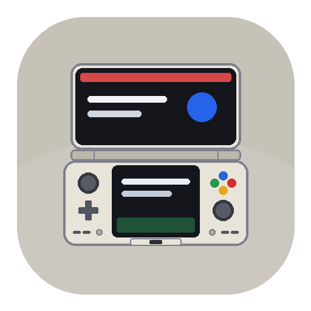

<p align="center">
  
</p>

# DualScreenBrowser（AYN Thor 雙螢幕掌機瀏覽器）

專為 **AYN Thor** 雙螢幕摺疊掌機（上方 6 吋 16:9 `1920×1080` 螢幕 ＋ 下方 3.92 吋 8:7 `1240×1080` 螢幕）打造的 Android 雙螢幕瀏覽器，支援**雙螢幕獨立瀏覽**與**跨螢幕無縫拼接（Span Mode）**，並內建實體手把快捷鍵與多指觸控板模式。

---

## 主要功能

### 1. 雙螢幕模式
- **獨立模式（Independent Mode）**：上下螢幕各自擁有獨立的 `WebView` 與多分頁管理，支援**網址傳送至另一螢幕**與**上下螢幕內容互換**。
- **跨螢幕拼接模式（Span Mode）**：透過 `SpanEngine`（`VirtualDisplay` + `ImageReader`）將單一網頁從上螢幕連續延伸至下螢幕；下螢幕依實際物理寬度比例置中 1:1 裁切顯示，並支援**轉軸縫隙補償（Hinge Gap `0–48dp`）**與**下螢幕亮度／色溫微調**。

### 2. 全螢幕與統一浮動選單
- 隱藏狀態列與導覽列的純淨全螢幕瀏覽。
- 上下螢幕皆配有可自由拖曳的圓形浮動按鈕，展開後可操作：
  - 上／下一頁、重新整理、傳送網址至另一螢幕、分頁管理
  - 網址列（支援手把十字鍵經過，需按 `A` 或點擊才開啟輸入法編輯）
  - 書籤、瀏覽紀錄、頁內尋找（支援上／下筆切換）
  - 單螢幕截圖、拼接截圖與長截圖
  - 電腦版網頁切換、手把操作說明、設定

### 3. AYN Thor 主機配色主題
內建 5 款對應 AYN Thor 實機外觀的配色主題（預設為 `Rainbow`），皆支援雙螢幕即時同步：
- **Black**（黑）
- **White**（白，淺色高對比介面）
- **Rainbow**（SNES 灰＋紅／藍／黃／綠四色 ABXY 分區點綴）
- **Clear Purple**（半透明紫透）
- **Custom**（自訂色相滑桿）

### 4. 手把與下螢幕觸控板
- **手把快捷操作**（可於設定開啟／關閉）：
  - `十字鍵 / 搖桿`：捲動網頁或瀏覽選單
  - `L1 / R1`：切換上／下一個分頁
  - `L2 / R2`：上一頁／下一頁
  - `X`：切換上下螢幕內容
  - `Y`：重新整理目前網頁
  - `Select`：切換手把目標螢幕（上螢幕／下螢幕）
  - `Start`：切換「拼接模式／獨立模式」
- **浮動多指觸控板**（拼接模式下可啟用）：
  - 單指移動鼠標／點擊、雙指捲動／縮放／回上一頁、三指重整
  - 拖曳左下角調整大小、拖曳右下角自由移動位置

### 5. 隱私與網頁增強
- 內建廣告網域阻擋（`AdBlocker`）與攔截計數
- 無痕分頁（Incognito）
- 強制深色網頁、解除網頁複製限制、自訂 UserScript 腳本管理
- 支援繁體中文、English 與跟隨系統語言切換（Android 13+ `LocaleManager` / `locales_config.xml`）

---

## 開發環境與建置

- **Compile SDK**：`35`（`minSdk = 33`, `targetSdk = 35`）
- **語言與架構**：Kotlin、Jetpack Compose（上螢幕 UI）＋ Android `Presentation`（下螢幕副顯示器）

### 單元測試與 Release APK 建置

```bash
# 執行 Release 單元測試與編譯正式版 APK
./gradlew testReleaseUnitTest assembleRelease
```

建置完成後的正式版 APK 輸出路徑：
`app/build/outputs/apk/release/app-release.apk`

### 安裝至裝置（USB / 無線 ADB）

```bash
adb install -r -d app/build/outputs/apk/release/app-release.apk
adb shell am start -n com.yangyws.dualscreenbrowser/.MainActivity
```

---

## 專案結構

- `app/src/main/java/com/yangyws/dualscreenbrowser/MainActivity.kt`：主視窗、Compose 瀏覽器介面、上螢幕選單與設定同步橋接
- `app/src/main/java/com/yangyws/dualscreenbrowser/browser/SecondaryBrowserPresentation.kt`：下螢幕 `Presentation`、獨立多分頁管理、下螢幕浮動選單與觸控板
- `app/src/main/java/com/yangyws/dualscreenbrowser/browser/SpanEngine.kt`：跨螢幕 `VirtualDisplay` 擷取與觸控座標映射引擎
- `app/src/main/java/com/yangyws/dualscreenbrowser/browser/GamepadController.kt`：AYN Thor 手把按鍵與搖桿事件處理
- `app/src/main/java/com/yangyws/dualscreenbrowser/browser/BrowserModels.kt`：資料模型、`ThorTheme` 配色定義與 `BrowserPrefs` 偏好設定
- `app/src/main/java/com/yangyws/dualscreenbrowser/ui/`：`BrowserUiComponents.kt`、`SpanViewportView.kt`、`ThorTutorialOverlay.kt`

---

## 授權條款（License）

本專案採用 **GPLv3 + MIT 雙重授權（Dual License）**，使用者可依需求任選其一授權條款使用：

- [GNU General Public License v3.0 (GPLv3)](LICENSE-GPLv3)
- [MIT License](LICENSE-MIT)

`SPDX-License-Identifier: GPL-3.0-or-later OR MIT`
